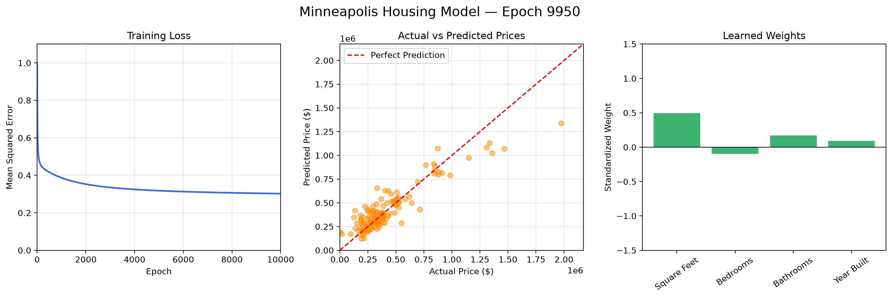

# Minnesota Housing Price Predictor

A multiple linear regression model built from scratch using Python and NumPy to predict residential property prices in Minneapolis, Minnesota.

The project demonstrates fundamental machine learning concepts, including gradient descent, feature engineering, data preprocessing, and model evaluation.

## Project Overview

This model predicts residential property sale prices using:

- Square footage
- Number of bedrooms
- Number of bathrooms
- Year built
- Neighborhood

The model was implemented without using machine learning frameworks such as scikit-learn, PyTorch, or TensorFlow.

NumPy handles the mathematical operations, while Pandas is used for data processing.

## Model Architecture

The model uses multiple linear regression:

$$
\hat{y} = Xw + b
$$

Where:

- X represents the input features.
- w represents the learned weights.
- b represents the bias.
- ŷ represents the predicted house price.

The model is trained using batch gradient descent and Mean Squared Error (MSE).

## Dataset

The project uses publicly available Minneapolis property data.

Data sources:

- Minneapolis Property Sales (2021–2025)
- Minneapolis Assessor Parcel Data (2020)

The data pipeline downloads property sales, retrieves matching property characteristics, joins records using property identification numbers, and removes invalid or duplicate records.

The training dataset contains approximately 4,636 residential properties.

The dataset is not included in the repository but can be reproduced using `build_dataset.py`.

## Model Performance

The final model uses 79 input features, including one-hot encoded neighborhoods.

| Metric | Result |
|---|---|
| Training examples | 3,708 |
| Testing examples | 928 |
| Mean Absolute Error | $82,163 |
| Root Mean Squared Error | $151,418 |
| R² Score | 0.6879 |
| Training epochs | 10,000 |

Performance was evaluated using an 80/20 random train/test split.

## Training Visualization

The project includes a live Matplotlib dashboard displaying:

1. Training loss over time
2. Actual versus predicted housing prices
3. Learned feature weights



## Installation

Clone the repository:

```bash
git clone https://github.com/YOUR_USERNAME/minnesota-housing-price-predictor.git

cd minnesota-housing-price-predictor
```

Create a virtual environment:

```bash
python3 -m venv .venv

source .venv/bin/activate
```

Install dependencies:

```bash
python -m pip install -r requirements.txt
```

## Usage

Download and prepare the housing dataset:

```bash
python build_dataset.py
```

Train the model and view the live dashboard:

```bash
python train_housing.py
```

Run automated tests:

```bash
python -m pytest -v
```

## Technologies

- Python
- NumPy
- Pandas
- Matplotlib
- Requests
- pytest
- Git and GitHub

## Limitations

- The model only covers Minneapolis residential property sales.
- Housing prices depend on features not included in the dataset, such as renovations, property condition, and local market conditions.
- Property characteristics come from 2020 assessor data, while sale records cover 2021–2025.
- Some unusual transactions may remain in the dataset.
- The model uses linear relationships and may not capture complex nonlinear patterns.
- Results are based on a random train/test split rather than a chronological evaluation.

This project is intended as an educational demonstration of machine learning fundamentals rather than a production property valuation system.

## Future Improvements

- Compare against neural network models.
- Add more property characteristics.
- Improve transaction filtering.
- Evaluate using chronological data splits.
- Build an interactive prediction interface.